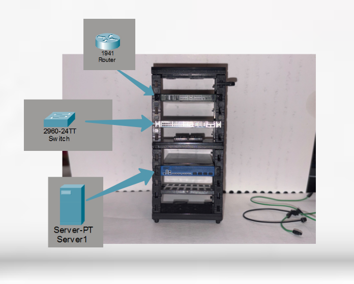
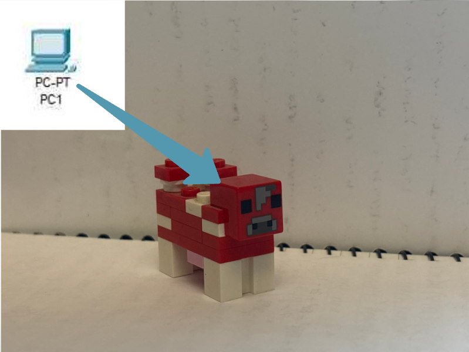
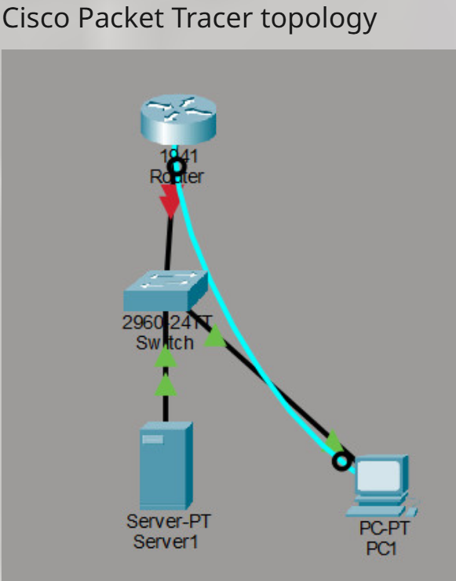
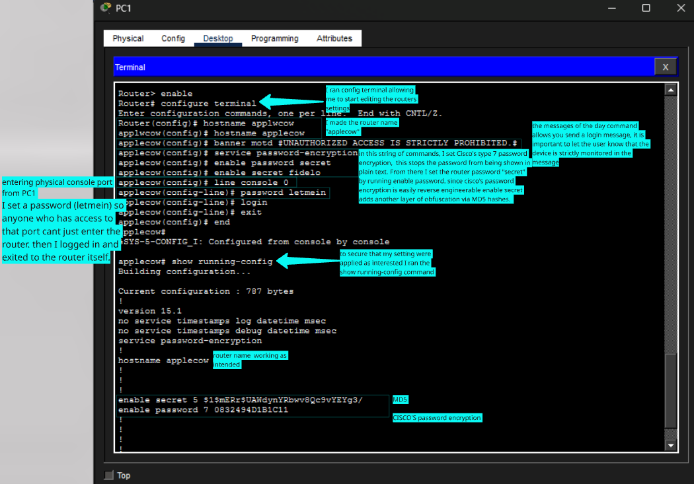
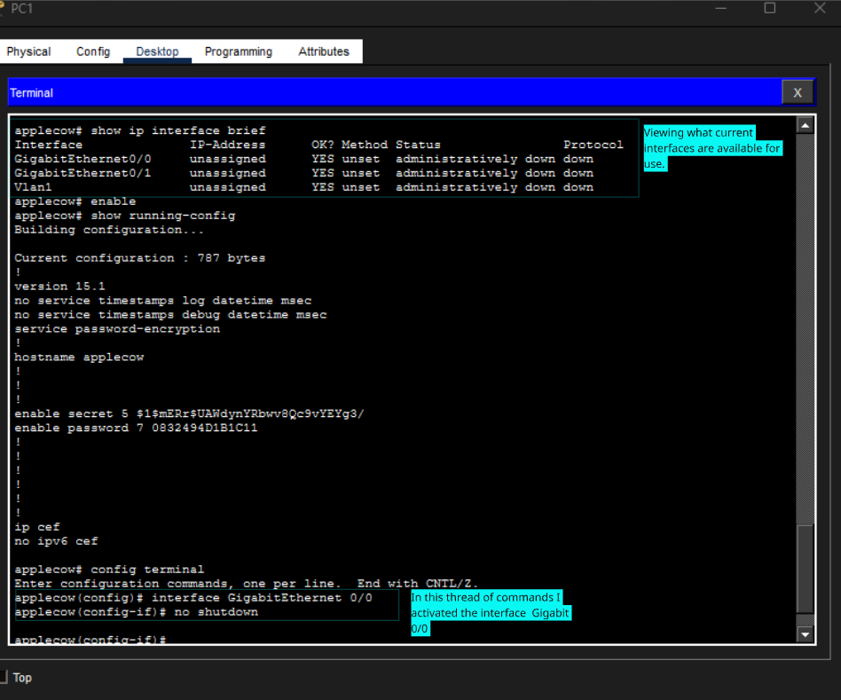

# From Mini Rack to Virtual Network
### Building, Configuring & Troubleshooting a Small Business Network with Cisco Packet Tracer

> A miniature network rack inspired a hands on networking project. I'm recreating its device roles in Cisco Packet Tracer, learning how network infrastructure is configured, and documenting the process from initial topology to a functioning network.

---

## 🗺️ Project Overview

This project explores how a small-business network is designed, configured, and maintained.

The idea started with a mini server rack containing three network appliances. Rather than just displaying them, I decided to recreate their intended roles inside Cisco Packet Tracer and use the project as a practical networking lab.

The Cisco Packet Tracer includes:
- A Cisco 1941 router
- A Cisco 2960 switch
- A Server-PT device
- A PC-PT workstation

The goal is to visually interpret the initial topology by configuring network devices, understanding how they communicate, testing connectivity, and documenting troubleshooting scenarios.

**Project status:** complete!

## 🧩 Physical to Virtual Architecture

One of the main ideas behind this project is to emulate a physical rack setup into a virtual network.

| Physical Miniature | Packet Tracer Device | Assigned Role |
|---|---|---|
| Furukawa Electric FITELnet FX2 | Cisco 1941 Router (R1) | Routing |
| Cisco Catalyst 9300 Series | Cisco 2960 Switch (S1) | Switching |
| A10 Networks Thunder 7655S | Server-PT (SRV1) | Server representation |
| External workstation | PC-PT (PC1) | Administration and end-user access |

 

*Note: The miniature appliances are decorative representations, not functional networking equipment. The A10 Networks Thunder 7655S is an application delivery controller, while Server-PT represents a general server role in this simulation.*

## 🔍 Network Topology

The initial topology establishes the connections between the router, switch, server, and workstation.



### Connection Map

| Source | Destination | Connection |
|---|---|---|
| R1 GigabitEthernet0/0 | S1 GigabitEthernet0/1 | Ethernet |
| S1 FastEthernet0/1 | SRV1 FastEthernet0 | Ethernet |
| S1 FastEthernet0/2 | PC1 FastEthernet0 | Ethernet |
| PC1 RS-232 | R1 Console | Console |

### Management Access

PC1 serves as the workstation used to administer the router.

A direct console connection was chosen because it allows access to the router's CLI without depending on an already operational network connection.

Packet Tracer's Desktop → Terminal interface provides a convenient GUI based way to access the command line.

## ⚙️ Configuration & Implementation

### Router — Initial Configuration



The first configuration exercise focuses on establishing administrative access and securing the router.

Work completed:
- Accessed the router through the PC1 console connection.
- Entered privileged EXEC mode.
- Inspected the default configuration using `show running-config`.
- Configured the router hostname.
- Created a Message of the Day (MOTD) banner.
- Enabled password encryption.
- Configured privileged EXEC authentication.
- Configured console authentication.

### Interface Activation

The router-to-switch Ethernet connection initially appeared red.

After inspecting the router's available interfaces, I identified GigabitEthernet0/0 as the interface connected to the switch.

I entered interface configuration mode and executed:

```cisco
configure terminal
interface GigabitEthernet0/0
no shutdown
```

This removed the administrative shutdown state and allowed the router-to-switch physical link to become active.



## 🔍 Troubleshooting & Technical Observations

Rather than only documenting successful configurations, this section records what happened, why it happened, and how it was resolved.

| Observation | Investigation | Resolution |
|---|---|---|
| Router-to-switch link appeared red | Inspected the router interface status | Enabled GigabitEthernet0/0 using `no shutdown` |
| Router configuration needed to be accessed before network setup | Used a direct console connection | Connected PC1 RS-232 to R1 Console |
| Needed to identify available router interfaces | Used `show ip interface brief` | Identified the available interface names and states |

### Important Networking Concepts

**Console access vs. Ethernet connectivity**

Console access provides an administrative connection to a network device. It does not depend on the router having an operational Ethernet connection.

**Administrative shutdown vs. physical connectivity**

A cable can be connected correctly while an interface remains administratively disabled. The interface must be enabled before its link can become operational.

**Running configuration vs. startup configuration**

The running configuration represents the active configuration in RAM, while the startup configuration is stored in NVRAM and is used when the device restarts.

## 📓 Development Journal

This project is being documented as a series of entries to show how the network develops over time.

### 🚀 ENTRY 1 — Bringing the Mini Rack to Packet Tracer
- Translated the miniature rack into virtual network device roles.
- Built the initial topology.
- Established Ethernet and console connections.
- Documented the physical-to-virtual mapping.

### 🚀 ENTRY 2 — Bringing the Router to Life
- Established console access through PC1.
- Inspected the router's default configuration.
- Applied initial router security settings.
- Enabled GigabitEthernet0/0.
- Established the first active router-to-switch link.

*Future entries will document additional configurations, connectivity testing, and troubleshooting.*

## 🧠 Skills & Concepts Practiced

- Cisco IOS command-line interface (CLI)
- Router initialization and configuration
- Console-based device administration
- Ethernet interfaces and link states
- Password security and encryption
- Network topology design
- Basic network troubleshooting
- Running and startup configurations
- Technical documentation
- Physical-to-virtual infrastructure mapping

## 📂 Repository Structure

```text
mini-rack-virtual-network/
│
├── README.md
│
├── images/
│   ├── physical-rack.png
│   ├── topology.png
│   ├── console-access.png
│   ├── router-configuration.png
│   └── interface-activation.png
│
├── topologies/
│   ├── Topology_built_Update_1.pkt
│   └── Topology_built_Update_4.pkt
│
├── configurations/
│   └── R1-running-config.txt
│
└── documentation/
    ├── lab-notes.md
    ├── troubleshooting.md
    └── network-design.md
```

## 🎯 Future Development

The project will continue to evolve as additional networking concepts are introduced.

Planned areas of development:
- Complete initial router configuration and verification.
- Configure switch management and switching fundamentals.
- Develop an IP addressing scheme.
- Configure server network services.
- Test connectivity between network devices.
- Document troubleshooting scenarios.
- Expand the topology as new concepts are learned.

## 💡 Project Philosophy

The goal isn't just to make a network that works in Packet Tracer.

It's to understand why it works, recognize when something doesn't, and develop the ability to troubleshoot it.

Each configuration, test, and problem becomes part of the documentation.
